# agentflow architecture

This document is the map for contributors and new developers. It explains how agentflow is put together, how a run moves through it, and where each piece of behaviour lives. It summarises the design without replacing it. For the authoritative detail, follow the links:

- [`CLAUDE.md`](CLAUDE.md): commands, invariants and a module-by-module description.
- [`docs/agentflow-harness-proposal.md`](docs/agentflow-harness-proposal.md): the current design (§1b engine/pack, §1c plug and play, §5 rollout).
- [`docs/agentflow-playbook.md`](docs/agentflow-playbook.md): how to operate runs (§10 cheat sheet, §11 safety model, §14 pack reference, §15 lessons and retros).
- [`docs/specs/`](docs/specs/): one proposal per module (conformance, cost, doubt review, dashboard UX, …).

The diagrams use Mermaid, which GitHub renders inline.

---

## 1. What agentflow is

agentflow is a **headless runner**. It drives an agent CLI (`claude -p` or `codex exec`) through a config-driven SDLC workflow and ends with a pull request that is ready for review:

```
define → plan → build → verify → review → ship
```

Every **step** is exactly one agent session. The runner, not the model, decides what comes next. It walks the configured phases, evaluates conditions from files and git, runs the quality gates, commits, pushes and opens the PR. Agents only edit files and write a `result.json`.

**Core rule: the model never decides the next phase.** The harness proposal relaxes this to *"the model proposes, the harness disposes"*: a model may choose *how* the work gets done, but the harness always decides *what "done" means*. The conductor that would let a model pick its own route is still a design and isn't built. Today the model's choices are limited to effort sizing and route profiles, both of which are bounded by rules (see §10).

---

## 2. System context

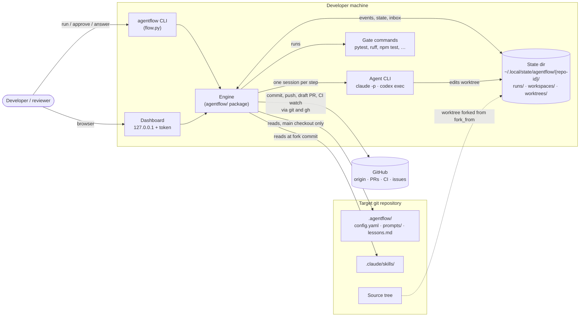

Key points:

- Each run works in its **own git worktree**, on a branch `flow/<lane>/<slug>` forked from `project.fork_from`. The worktree lives in the state dir, outside the repo.
- The engine is **stdlib + `pyyaml` only**. It talks to git and `gh` through subprocess argv (no shell) and to the agent through its CLI.
- Humans interact through the CLI (`approve`, `answer`, `reject`, `inbox`, …) or the local dashboard. Both write to the same append-only event log.

---

## 3. Engine and pack

The single most important architectural split: **the engine is generic, and the pack is one project's configuration.**

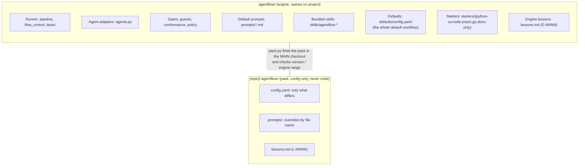

| Concern | Engine (generic) | Pack (a project's values) |
|---|---|---|
| Workflow | phase and step mechanics, lanes as data | which steps, skills and prompts a lane runs |
| Quality bar | gate runner, obligation engine, conformance audit | `gates`, `gate_sets`, extra `policy.obligations` |
| Conditions | generic checks (`file_exists`, `grep`, `section_items`, `status_line`, `changed_paths`, `plan_tasks`, …) | named conditions with the project's paths |
| Guardrails | the engine floor, guard checks, deny-rule generation | `forbidden_paths`, `reject_trailers`, `user_only_skills` |
| Prompts and skills | default templates and bundled `agentflow-*` skills | overrides in `.agentflow/prompts/` and `project.skills_dir` |

Two tests enforce the split. `test_portability.py` fails when a project-specific string appears in any engine file. The suite also runs against two toy fixture packs (`fixtures/packs/python` and `fixtures/packs/node`).

### 3.1 Config layering

`layers.py` merges four layers before `config.py` resolves `@a.b.c` references and builds typed dataclasses:

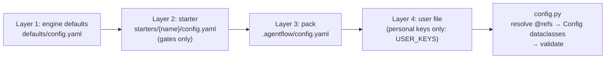

A pack therefore states only what differs. `agentflow config show --effective` prints each value together with the layer it came from. `agentflow validate` must print `0 warnings` after any config edit.

### 3.2 Prompt and skill resolution

- **Prompts**: the pack's `.agentflow/prompts/<name>.md` wins over the engine's `agentflow/prompts/<name>.md`. Shared partials: `_preamble.md`, `_step_head.md`, `_result.md`.
- **Skills**: the repository's `project.skills_dir` (default `.claude/skills`) wins over the engine's bundled `agentflow/skills/agentflow-<stage>/`. A repository with no skills still works.
- **A step's skill is its brief.** A step with no `brief:` of its own gets its skill's `SKILL.md` as its brief. A repository skill is read from the run's fork commit, never from the worktree the agent is editing.

---

## 4. Repository layout

```
agentflow-harness/
├── agentflow/                 # the engine (Python package; flow.py is the CLI)
│   ├── defaults/config.yaml   # layer 1: the whole default workflow
│   ├── starters/              # layer 2: gate presets for `agentflow init`
│   ├── prompts/               # default prompt templates
│   ├── skills/                # bundled generic skills (agentflow-define, -plan, -build, …)
│   ├── dashboard.html         # dashboard shell
│   ├── dashboard_ui/*.js      # dashboard scripts (board, inbox, run, plan, metrics, settings, …)
│   ├── lessons.md             # engine lessons (E-NNNN)
│   └── tests/                 # pytest suite, fake agent, fake gh, fixture packs and repos
├── .agentflow/                # this repository's own pack (agentflow working on itself)
├── .claude/skills/            # vendored workflow skills (see VENDORED.md)
├── bin/agentflow              # runs flow.py as a uv script
├── docs/                      # proposal, playbook, specs/, plans/
├── AGENTS.md                  # rules for non-Claude agents in a run
├── CLAUDE.md                  # rules and module guide for Claude Code
└── CHANGELOG.md               # Keep a Changelog; every user-visible change
```

---

## 5. Module map

About 36k lines across roughly 75 modules. The groups below describe responsibilities. Dependencies run mostly downward.

```mermaid
flowchart TB
    subgraph Entry["Entry points"]
        flow["flow.py<br/>argparse CLI"]
        dashboard["dashboard.py<br/>HTTP + SSE"]
        retro["retro.py<br/>retro pipeline"]
        setup["init.py · doctor.py · detect.py"]
    end

    subgraph Orchestration["Orchestration"]
        pipeline["pipeline.py<br/>phase loop (_Loop)"]
        flowctl["flow_control.py<br/>StepControl: next step, step kinds"]
        lanes["lanes.py<br/>Executor: agent step lifecycle"]
        mixins["Executor mixins:<br/>feature_lane · bug_eval · sync_lane · ci_lane<br/>sizing_lane · route_lane · governor_lane"]
        autonomy["autonomy.py<br/>Resolver, refine rounds"]
        doubt["doubt.py<br/>spec/plan doubt review"]
        overlays["overlays.py<br/>security overlay"]
    end

    subgraph Execution["Execution and safety"]
        agents["agents.py<br/>claude / codex adapters, stream parsing"]
        brief["brief.py<br/>run brief (system prompt)"]
        gates["gates.py<br/>gate runner, fix loop input"]
        guards["guards.py<br/>forbidden paths, HEAD, skills, trailers"]
        gitops["gitops.py · commit_checks.py<br/>only the runner commits/pushes"]
        workspace["workspace.py · run_env.py · safeio.py"]
        policy["policy.py · conformance.py"]
    end

    subgraph StateL["State"]
        events["events.py<br/>append-only events.jsonl + run lock"]
        state["state.py<br/>Run: reduce events → state.json"]
        hitl["hitl.py<br/>result schema, inbox, approve/answer"]
        runctl["run_control.py<br/>pause/resume/cancel/retry"]
    end

    subgraph Config["Config"]
        pack["pack.py"]
        layers["layers.py"]
        config["config.py<br/>dataclasses, @refs, validate"]
        trust["config_trust.py"]
        conditions["conditions.py · sources.py"]
        cfgedit["config_edit.py · pack_fix.py"]
    end

    subgraph ReadOnly["Read-only views and analytics"]
        views["views.py · metrics.py · activity.py · sessions.py<br/>transcripts.py · artifacts.py · plan_view.py · inbox_view.py"]
        learn["signals.py · lessons.py · scorecard.py"]
        work["work_source.py · module_queue.py · backlog.py · finished.py"]
    end

    subgraph Graph["Knowledge graph (not part of a run)"]
        gbuild["graph_build.py<br/>delta build of the base branch"]
        gparse["graph_parse.py → graph_worker.py<br/>child process: extractors"]
        gstore["graph_store.py<br/>one SQLite file"]
        greport["graph_report.py<br/>text and JSON views"]
    end

    flow --> pipeline
    flow --> gbuild
    gbuild --> gparse
    gbuild --> gstore
    flow --> greport
    dashboard --> views
    dashboard --> hitl
    dashboard --> runctl
    pipeline --> flowctl --> lanes
    lanes --- mixins
    pipeline --> autonomy
    pipeline --> doubt
    lanes --> agents
    lanes --> brief
    lanes --> gates
    lanes --> guards
    lanes --> gitops
    lanes --> workspace
    pipeline --> state --> events
    lanes --> hitl
    pipeline --> config
    config --> layers --> pack
    flowctl --> conditions
    mixins --> policy
```

### 5.1 Module reference

| Area | Module | Responsibility |
|---|---|---|
| **CLI** | `flow.py` | `init`, `doctor`, `validate`, `config`, `run`, `resume`, `explain`, `next`, `status`, `inbox`, `answer`, `approve`, `reject`, `pause`, `cancel`, `retry`, `archive`, `attach`, `queue`, `backlog`, `metrics`, `scorecard`, `lessons`, `retro`, `graph`, `dashboard` |
| **Phase loop** | `pipeline.py` | `start` creates the run and its worktree. `advance` holds the run lock and walks phases, then settles each one (approval, refine and reconcile rounds), writes `handoff.md` and reloads the pack before each phase. |
| | `flow_control.py` | `StepControl`: walks a phase's steps and handles `when`/`unless`, groups with `repeat`, checkpoints, gate steps, `foreach`, `finish` and `ci`. Also produces the dry-run output. |
| | `keepawake.py` | Holds a sleep inhibitor (`caffeinate` or `systemd-inhibit`) while a run advances. |
| **Agent step** | `lanes.py` | `Executor.run_agent_step`: budget → model and effort → prompt → call → guards → result → gates and fix loop → rollover → commit. |
| | `agents.py` | `ClaudeAgent` and `CodexAgent`: argv and env, stream-json parsing, cost and usage, interruptions. |
| | `brief.py` | Renders the appended system prompt: repo rules, preamble, skill, briefs and the result contract, all read at the fork commit. |
| **Lane mixins** | `feature_lane.py` | Plan tasks (`foreach: plan_task`), batching, per-task review, commits that tick `- [ ]`, `finish`. |
| | `bug_eval.py` | Red/green expectations: the regression test must fail, then the fix must make it pass. |
| | `intake.py` | What a bug or eval run starts from (`--issue`, `--log`, `--task`). |
| | `sync_lane.py` | `finish` merges `origin/<fork_from>` and resolves conflicts in an agent session. |
| | `ci_lane.py` | Waits for CI, fixes failures, marks the PR ready. It never merges. |
| | `sizing.py` / `sizing_lane.py` | A read-only sizer session answers a checklist, and a pure rule picks `low`/`medium`/`high` effort. |
| | `route.py` / `route_lane.py` | Triages a run at its start into an `XS`/`S`/`M`/`L` route profile, which can drop ceremony but never an obligation. |
| | `governor.py` / `governor_lane.py` | Holds runs against Claude's 5-hour and 7-day usage windows, using a machine-wide file. It fails open. |
| | `carry.py` | Decides whether a plan task may resume the previous task's session. |
| | `preflight.py` | Checks once that this machine can run the lane's gates. |
| **Autonomy** | `autonomy.py` | `Resolver` sessions for stops, refine rounds on blocking findings, auto-answers to recommended questions (except `boundary` questions). |
| | `doubt.py` | Adversarial review of a spec or plan before approval, reconcile rounds, dispositions and stop rules. |
| | `overlays.py` | The security overlay: extra skills, a review agent and an approval note when `security_path` holds. |
| **Safety** | `guards.py` | Refuses forbidden paths, `.agentflow/**`, moving `HEAD`, user-only skills and rejected trailers. |
| | `gitops.py`, `commit_checks.py` | The only code that commits and pushes. Includes the hardened `read_blob` / `verified_tree_paths`. |
| | `workspace.py`, `run_env.py`, `safeio.py` | The one writable dir outside the worktree, the agent and gate environment, and writes that never follow symlinks. |
| | `policy.py`, `conformance.py` | Obligations (`verified`, `reviewed`, `plan_approved`, `red_then_green`, plus the pack's), audited at `finish`. |
| **State** | `events.py` | Append-only `events.jsonl` (`seq`, `ts`, `type`, `by`) with a file lock, plus `RunLock`. |
| | `state.py` | `Run`: the only writer, which reduces events into `state.json`. |
| | `hitl.py` | `result.json` schema, inbox items, notifications, `answer` / `approve` / `reject`. |
| | `run_control.py` | `pause`, `resume`, `cancel`, `retry`, `archive`, `attach`. |
| | `issue_status.py` | Marks the source GitHub issue and links the PR. A GitHub error never fails a run. |
| **Config** | `pack.py`, `layers.py`, `config.py`, `config_trust.py` | Find the pack, merge the layers, type and validate it, and decide which config a resumed run may use. |
| | `conditions.py`, `sources.py` | Named condition checks, prompt placeholders, `explain`, and reading plans and specs. |
| | `config_edit.py`, `pack_fix.py` | Dashboard Settings editing that keeps comments and anchors, and `validate --fix` for retired prompt text. |
| **Work intake** | `work_source.py`, `module_queue.py`, `backlog.py`, `finished.py` | `next`, `queue`, the dashboard Backlog, and which modules are done. |
| **Learning** | `signals.py`, `lessons.py`, `scorecard.py`, `retro.py`, `metrics.py` | Signals per run, lessons injected into prompts, before/after effects, baseline scorecard, retro PRs. |
| **Views** | `views.py`, `activity.py`, `sessions.py`, `transcripts.py`, `artifacts.py`, `plan_view.py`, `inbox_view.py`, `run_files.py`, `verification.py` | Pure or read-only passes over events and git for the CLI and dashboard. |
| **Setup** | `detect.py`, `init.py`, `doctor.py` | Read a repo from its base branch, write a sparse pack, check the machine. |
| **Knowledge graph** | `graph_model.py` | The vocabulary: node and edge kinds, the `Facts` an extractor returns and `check_facts`, which distrusts them. The worker imports it, so it is stdlib only. |
| | `graph_ignore.py` | A pure `.gitignore` matcher with no regular expression and a per-path work budget; also holds `graph.exclude`. |
| | `graph_select.py` | One verdict per tracked path (`indexed`, `ignored`, `secret`, `vendored`, `excluded`, `symlink`, `submodule`, `unparsed`) and the language to parse it as. |
| | `graph_python.py`, `graph_markdown.py`, `graph_manifest.py` | Extractors that return facts from `ast`, Markdown and `pyproject.toml` / `requirements*.txt` / `package.json`. They run in the worker and import nothing but `graph_model`. |
| | `graph_syntax.py` | The tree-sitter extractor for TypeScript, TSX and JavaScript. Only the worker imports it, and only under the locked `uv` mode. |
| | `graph_worker.py` | The parser process: a `uv` script with three pinned packages and a hash lock (`graph_worker.py.lock`). It reads one file's bytes at a time and answers with JSON. |
| | `graph_parse.py` | The engine's side of the worker: starts and limits the child, falls back to the stdlib mode, and checks every reply with `check_facts`. |
| | `graph_resolve.py` | Pure: turns one file's facts into nodes and edges and names the keys (`path:`, `py:`, `pkg:`) that tie files together. |
| | `graph_store.py` | The SQLite store (`<state dir>/graph/graph.sqlite`), built as a copy and swapped in by rename: tables, FTS5 search, `neighbours`. Every value is a bound parameter. |
| | `graph_git.py` | The reads from git: a commit's tree, the difference of two commits and blobs by id, hardened and never touching a remote or a working tree. |
| | `graph_build.py` | `build`: the delta over the last snapshot (change list, `.gitignore`, facts, resolution), parsing only changed blobs, under `build.lock`. |
| | `graph_report.py` | Pure: the text and JSON views of `agentflow graph build`, `status`, `query` and `show`. |

`Executor` combines the step lifecycle with every lane behaviour through mixins:

```python
class Executor(BugEvalLane, StepControl, FeatureLane, SyncLane, CILane, SizingLane, RouteLane, GovernorLane): ...
```

---

## 6. The workflow

### 6.1 Phases, lanes and steps

`defaults/config.yaml` defines **one** workflow. A **lane** (`feature`, `bug`; `eval` and `design` exist only in the `python` fixture pack) selects which steps of it run. A phase in which no step runs for the lane is skipped.

The diagram shows the **engine's default** workflow. A pack that writes the `steps` of any phase replaces the whole workflow (`layers.py`), so steps are never merged with the defaults. This repository's pack does so:

- `define` adds an `idea` group (grilling, used only when no spec exists) and a `contracts` step (`api-and-interface-design`).
- `review` adds a `security_review` step, run when `security_path` holds and required by the pack's `security_reviewed` obligation.
- It has no automated doubt review: `spec_review`, `spec_reconcile`, `plan_review` and `plan_reconcile` are absent, so the spec and the plan go straight to the human approval. Instead, on a security path, `plan`'s approval note offers `doubt-driven-development` for the human to run. The runner never runs it.

Use `agentflow config show --effective phases`, or `agentflow explain <lane> --module <id>`, to see what a given pack runs.

```mermaid
flowchart LR
    subgraph define["define (needs approval)"]
        d1["debug (bug)"]
        d2["draft spec"]
        d3["grill open questions<br/>⟲ until none, max 2"]
        d4["spec_review (doubt)<br/>⇄ spec_reconcile"]
    end
    subgraph plan["plan (needs approval)"]
        p1["plan"]
        p2["plan_review (doubt)<br/>⇄ plan_reconcile"]
    end
    subgraph build["build (auto)"]
        b0["setup gate"]
        b1["foreach plan_task<br/>implement → gates → fix loop<br/>→ task review → commit"]
        b2["regression_test: expect red (bug)"]
        b3["fix: expect green (bug)"]
    end
    subgraph verify["verify (auto)"]
        v1["gates first → verify session<br/>→ fix loop"]
    end
    subgraph review["review (auto)"]
        r1["branch_review"]
        r2["refine round:<br/>plan_fixes → fix_findings"]
    end
    subgraph ship["ship (auto)"]
        s1["finish: sync origin/fork_from,<br/>conformance, push, draft PR"]
        s2["ci: watch, fix, mark ready"]
    end

    define --> plan --> build --> verify --> review --> ship
    r1 -. blocking findings .-> r2 -.-> r1
```

| Lane | Path through the workflow |
|---|---|
| `feature` | draft spec → grill → doubt review → **human approves spec** → plan → doubt review → **human approves plan** → build each task → verify → review → ship |
| `bug` | debug (root cause) → **human approves** → failing regression test (`expect: red`) → fix (`expect: green`) → verify → review → ship |

A phase is skipped when its `skip_if` holds (for example, `plan` is skipped when a plan with unticked tasks already exists, and `build` is skipped when every task is ticked). Steps are gated by `when` / `unless` **conditions**, which `conditions.py` evaluates from files and git. A condition that comes out unknown follows its `on_unknown` setting: `false`, `ask_human`, or one `mechanical` agent call.

Use `agentflow explain <lane> --module <id>` to see exactly what a lane would run, with no agent calls. Its output for every lane of the `python` fixture pack is pinned by golden files (`tests/fixtures/explain/*.txt`) that must never change.

### 6.2 The phase loop (`pipeline._Loop`)

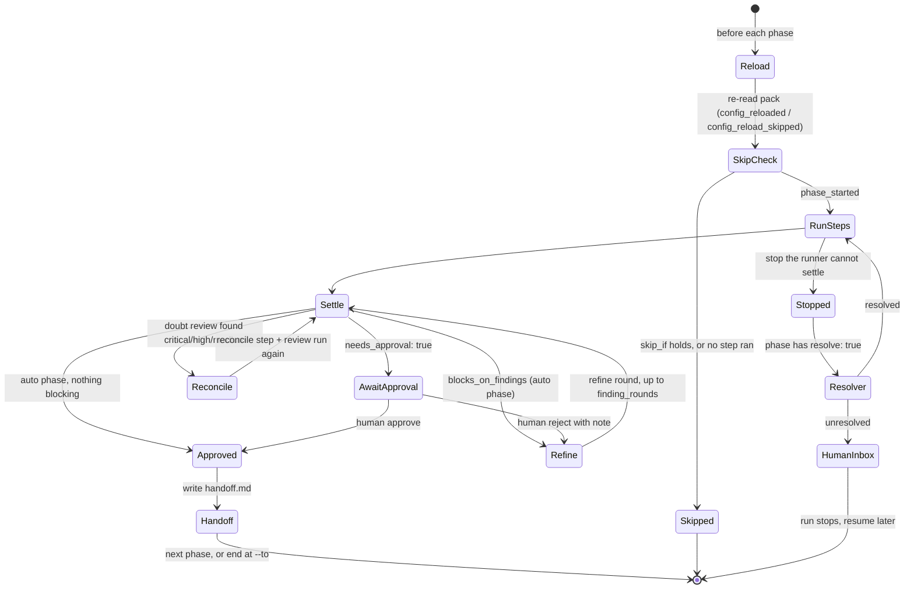

- `needs_approval: true` phases (`define`, `plan`) always stop for a human at `<phase>_approved`.
- Auto phases are approved by the runner once their `blocks_on_findings` steps report nothing blocking. Blocking findings open refine rounds, up to `autonomy.finding_rounds`, after which the phase goes to a human.
- A human `pause` or `cancel` is honoured **before every step**, so a live agent always finishes its current step first.

### 6.3 One agent step (`lanes.Executor.run_agent_step`)

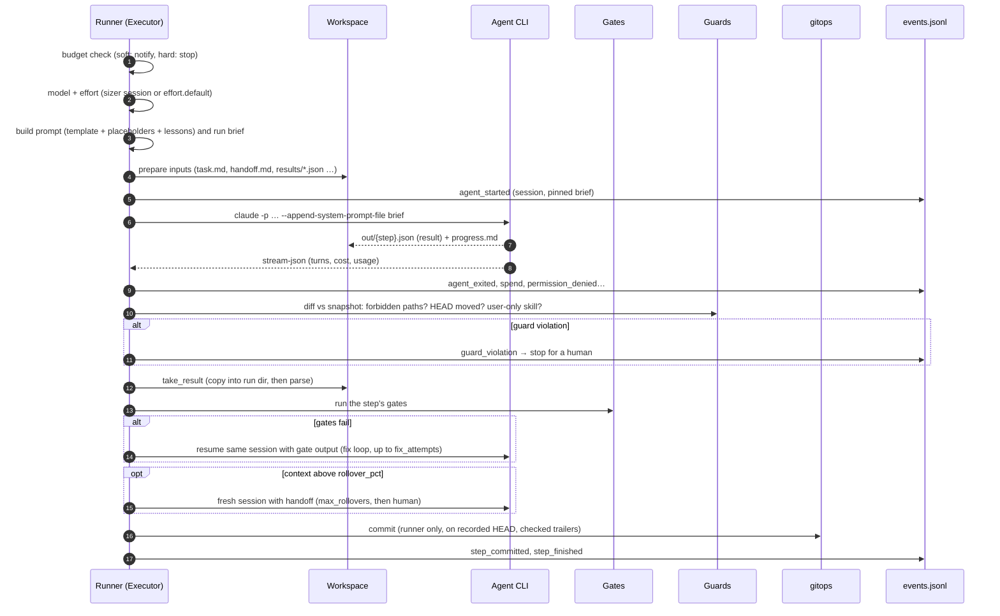

Everything needed to continue is in the event log, so a new `Executor` can **resume** a step's recorded session after a crash, a `pause`, or a usage-limit wait.

### 6.4 The feature lane's build phase

- `foreach: plan_task` walks the plan's `- [ ]` tasks. Each task gets an implementer session, its `build` gate set with a fix loop, then a fresh **task review** session. Blocking findings reopen the implementer's session with the `review_feedback` skill.
- `batch` groups up to 3 small tasks (≤ 3 files) into one session. `carry.py` decides when a task may resume the previous task's session.
- For a small plan (`plan_is_small`, ≤ 3 tasks), a single shared session runs `executing-plans` inline, without per-task review.
- Each task commit ticks its checkbox in the plan, so `plan_done` (and `build_done`) can be evaluated from git.

### 6.5 Ship

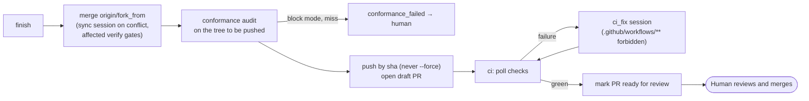

The runner **never merges**. Merging is always a human decision.

---

## 7. Human in the loop and autonomy

A run stops for a human only when the runner can't settle something by itself.

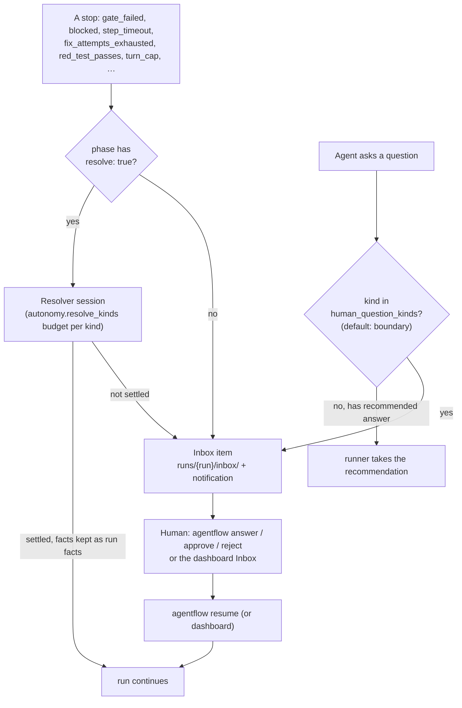

**Doubt review** (`doubt.py`): before a human sees a spec or a plan, a fresh `role: review` session reviews it adversarially. Its `critical`, `high` and `medium` findings open **reconcile rounds**, in which only the reconcile step (which may change only its `output` file) and the review run again. Findings are numbered `R<round>-F<n>`, each one gets a disposition, and stop rules (`unchanged`, `disputed`, `theater`, `bounded`) end the rounds. The approval page shows every finding's disposition.

---

## 8. State and persistence

### 8.1 Event sourcing

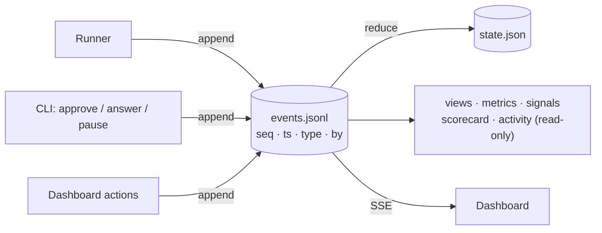

- `events.jsonl` is **the** record of a run. Writers take an advisory file lock, so the CLI, the dashboard and the runner can append concurrently without interleaving lines or reusing a `seq`.
- `state.Run` is the only writer of both files. `state.json` is a reduction of the events and can always be rebuilt from them.
- `RunLock` (`runner.lock`) ensures that only one runner advances a run at a time.
- Analytics (`metrics.py`, `signals.py`, `scorecard.py`, `activity.py`) are **pure functions over the event list**. They read no clock and no other files.

### 8.2 The state dir

Runs live outside the repository, in `paths.state_dir`, which defaults to `~/.local/state/agentflow/<repo-id>/`:

```
<state dir>/
├── runs/
│   ├── <run-id>/                 # source of truth; NO agent can write here
│   │   ├── events.jsonl          # append-only log (+ .lock)
│   │   ├── state.json            # reduced state
│   │   ├── runner.lock · runner.log
│   │   ├── inbox/                # pending human decisions
│   │   ├── results/              # checked copies of each step's result.json
│   │   ├── transcripts/          # agent stream logs
│   │   ├── handoff.md · issue.md · …
│   ├── queue.json · done_marks.json
├── workspaces/<run-id>/          # the agent's ONLY writable dir besides its worktree
│   ├── out/<step>.json           # result written by the agent (AGENTFLOW_RESULT)
│   ├── progress.md               # agent notes
│   └── task.md · handoff.md · results/*.json   # read-only input copies, refreshed each call
└── worktrees/<run-id>/           # the run's git worktree on flow/<lane>/<slug>
```

The machine-wide usage-window file used by the governor lives at `${XDG_STATE_HOME:-~/.local/state}/agentflow/usage_window.json`. It is a scheduling aid, not a security boundary.

---

## 9. Safety model and trust boundaries

agentflow treats the agent, the repository's contents and the agent's result text as **untrusted**.

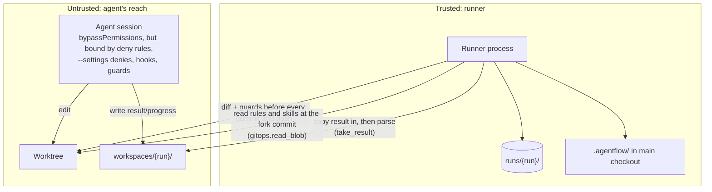

| Layer | What it enforces |
|---|---|
| **Engine floor** (a pack can't remove it) | non-empty `gate_sets.verify`; `.agentflow/**` always forbidden in a run; no user-only skills; at least one refine round for `critical`/`high`/`medium` findings; budget is a hard stop |
| **Guards** (`guards.py`) | forbidden paths, pack edits, `HEAD` moves, user-only skills, `reject_trailers` (for example, `Constraints-Approved-By`). Checked after every call and again before each commit and the push |
| **Git** (`gitops.py`) | only the runner commits and pushes, only on top of the `HEAD` it recorded, push by sha, never `--force`, never merge |
| **Filesystem** (`workspace.py`, `safeio.py`) | one writable dir outside the worktree; input copies replaced rather than written through; no symlink following |
| **Brief integrity** (`brief.py`) | repo rules and skills read at the fork commit through hardened, verified git reads, never from the worktree |
| **Config trust** (`config_trust.py`) | decides which config a resumed run may use |
| **Conformance** (`conformance.py`) | obligations audited at `finish` against the run's own events and the tree about to be pushed |
| **Dashboard** | binds `127.0.0.1`, needs a token on every data route, token only in the URL fragment |
| **Security overlay** | changes to guards, agents, config_trust, safeio, workspace, pack, layers, detect, init, pack_fix or brief add security skills and a security review agent |

**Residual risk:** gate commands execute code from the worktree, which the agent wrote, with your permissions. Review diffs at approvals, and use a disposable environment for risky work (playbook §11).

---

## 10. Cost, effort and scheduling

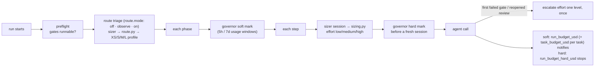

- **Effort** is sized per step by a short read-only session that answers a checklist. A pure rule (`sizing.py`) turns the answers into a level inside `effort.allowed`, and judgement steps (define, plan, review, debug) get at least `medium`.
- **Route profiles** drop ceremony for small work (for example, `XS` skips grilling and the doubt reviews). They never drop an obligation, and conformance still runs.
- **Budgets**: crossing the soft budget (`run_budget_usd`, which grows by `task_budget_usd` per open plan task when `build` starts) sends one notification. Crossing the hard budget (`run_budget_hard_usd`, 65 by default) stops the run. A usage limit just waits for its reset, while `recovery` bounds outages and failed attempts. Per-call turn and spend caps (`max_turns_by_role`, `session_budget_usd`) bound each session.
- **Watchdog**: a session whose stream stays quiet for `watchdog.no_progress_min` (15) minutes, or a read-only one idle for `read_only_idle_min` (5), is ended as `step_timeout`.
- **Context**: Claude Code auto-compacts at `context.autocompact_pct`. Above `rollover_pct` the runner starts a fresh session with a handoff, and after `max_rollovers` a human splits the task.

---

## 11. Learning loop: signals, lessons and retros

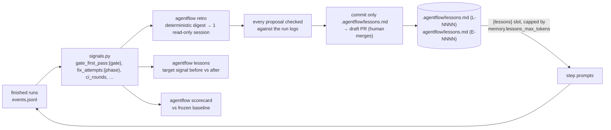

A retro session runs **read-only**. Any edit to the tree, the git configuration or hooks stops it before any commit or push. A stopped retro is cancelled and run again, never resumed.

---

## 12. Onboarding a repository

These commands run with no pack, or before one exists:

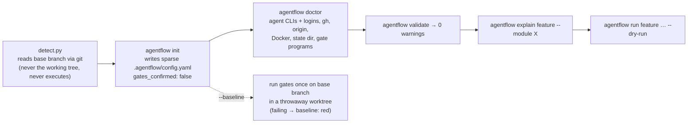

`detect.py` proposes the base branch, a starter, gates (CI workflow steps first, then `package.json` scripts, `pyproject.toml` tool sections and `Makefile` targets), docs folders and skills. Repository contents are untrusted: a malformed file becomes a note, not an error.

---

## 13. The dashboard

`agentflow dashboard` starts a stdlib `ThreadingHTTPServer` on `127.0.0.1` and prints `http://127.0.0.1:<port>/#token=<token>`.

- **Shell**: `dashboard.html` plus `dashboard_ui/*.js` (board, inbox, run, plan, sessions, activity, artifacts, metrics, lessons, settings, …), served from a fixed list.
- **API**: JSON routes (`/api/board`, `/api/runs/<id>`, `/api/inbox`, `/api/metrics`, `/api/scorecard`, `/api/lessons`, artifacts and diffs read from git, …) built on the read-only view modules.
- **Live updates**: Server-Sent Events (`/api/events`) stream every run's new events.
- **Actions**: approve, answer, reject, pause, resume, cancel, and start a run from the Backlog. Each action appends events the same way the CLI does.
- **Settings**: `config_edit.py` edits `config.yaml` while keeping comments and anchors. `_PROTECTED_KEYS` lists the keys the page may not change.

---

## 14. Testing architecture

- **No real model or GitHub.** `tests/fake_agent.py` is a scripted stand-in for `claude -p` (`AGENTFLOW_FAKE_SCRIPT`), and `tests/bin/gh` is a fake `gh`.
- **Isolation.** `conftest.py` points `XDG_STATE_HOME` at a tmp dir. Each fixture pack is copied into its own temp git repo.
- **Fixture packs.** `fixtures/packs/python` (the main one, with `feature`, `bug`, `eval` and `design` lanes) and `fixtures/packs/node`.
- **Plug and play.** `test_plug_and_play.py` runs `init`, `doctor`, `validate`, `explain` and `run --dry-run` on three toy repos with no pack (`python`, `node`, `docs`).
- **Golden files.** `fixtures/explain/*.txt` pin `explain` output and must stay byte-identical.
- **Portability.** `test_portability.py` scans every engine file against a project-name denylist.

```bash
# one file while you work
uv run --no-project --with pyyaml --with pytest pytest agentflow/tests/test_pack.py --import-mode=prepend -q
# full suite before you finish (25-60 min)
uv run --no-project --with pyyaml --with pytest pytest agentflow/tests --import-mode=prepend -q
# lint, required (CI runs the same pin)
uvx ruff@0.17.4 check .
```

---

## 15. Contributing: the checklist that follows from the architecture

| If you… | You must also… |
|---|---|
| add an import | keep it stdlib or `pyyaml`; no third-party dependency |
| touch any engine file | keep project names out (`test_portability.py`) |
| add or change a config key | add a Settings field or `_PROTECTED_KEYS` entry, the `validate` checks, a `test_config_edit.py` case and a playbook §14 line, all in the same change |
| drop or reword text in `agentflow/prompts/*.md` | add a `Retired` entry to `pack_fix.py` |
| change user-visible behaviour | add a line under `## [Unreleased]` in `CHANGELOG.md` |
| change guards, agents, config_trust, safeio, workspace, pack, layers, detect, init, pack_fix or brief | plan and review it with the `security-and-hardening` skill and the `security-auditor` agent |
| refactor anything `explain` touches | leave `tests/fixtures/explain/*.txt` byte-identical |
| release | bump `pyproject.toml` and `pack.ENGINE_VERSION` together, and rename `[Unreleased]` |

### Where to start reading the code

1. `agentflow/defaults/config.yaml`: the whole workflow as data.
2. `agentflow/pipeline.py` docstring and `_Loop`: how phases advance.
3. `agentflow/flow_control.py` docstring: how steps are chosen.
4. `agentflow/lanes.py` docstring and `Executor.run_agent_step`: one agent call end to end.
5. `agentflow/events.py` and `agentflow/state.py`: what is recorded and how state is derived.
6. `agentflow/guards.py` and `agentflow/workspace.py`: what keeps an agent in bounds.
7. Run `bin/agentflow explain feature --module <id>` and `bin/agentflow run feature … --dry-run` against this repo's own pack to see it all without spending a token.
