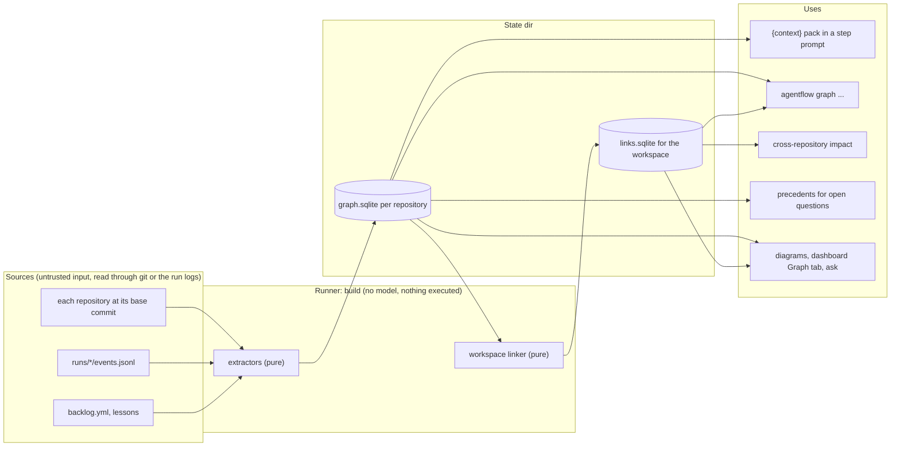

# Proposal: a knowledge graph of the workspace's code and a context graph of its decisions

Status: approved (2026-11-28; decisions settled by grilling the same day, see "Decisions")

Builds on `docs/specs/agentflow-workspace-proposal.md` (the workspace: `workspace.roots`, `repo_set.py`, one dashboard
for several repositories), `docs/agentflow-harness-proposal.md` §3.10 (memory tiers and the context hygiene rules) and
§1 ("the model proposes, the harness disposes"), and `docs/agentflow-doubt-review-proposal.md` (questions and findings
before a human approves). It changes no lane and no phase order. It amends one boundary of the workspace proposal
(a run may be *told facts* about another repository, section 5), and that amendment is opt-in.

## Objective

### The problem

agentflow can run in several repositories of a workspace, but it knows nothing about what is in them:

1. **Every session rediscovers the codebase.** A step gets paths (the spec, the plan, the handoff) and then greps. The
   first turns of `define`, `plan` and each build task go to finding where things live. Nothing carries "module X is
   defined here, used there, tested by this file" from one session to the next, so the same search is paid for in
   every session of every run.
2. **Nothing sees across repositories.** The workspace proposal's non-goals say it: "No cross-repository runs" and "No
   cross-repository dependencies". A run that changes a package, a route or a schema in repository A cannot know that
   repository B consumes it. The resolver has a stop class for it (`impact`: "a public contract breaks"), but no data
   to decide it with.
3. **Decisions are scattered and asked again.** Why something is the way it is lives in a proposal's `## Decisions`
   section, in a `hitl_answered` event of a finished run, in a lesson, in a PR body. The `define` phase turns a spec's
   Open Questions into questions for a human (`grill_spec_questions`), and with `autonomy.answer_recommended` the
   runner takes the model's recommended option. Neither looks up whether a human has already settled the same
   question. A human answers it again, or the model's guess stands where a recorded decision existed.
4. **No picture.** The dashboard draws agentflow's own workflow (`workflow.js`), not the product's: which repository
   depends on which, what a module touches, which path a request takes through the services.
5. **Nobody can ask.** "Which spec says how refunds are approved, and what implements it?" is answered today by
   opening files. There is no query over requirements, decisions and code together.

### What we build

One index with two layers, built by the runner and never by an agent:

- **The code graph**: repositories, packages, files, symbols, routes, tests and what connects them (`contains`,
  `imports`, `references`, `tests`, `depends_on`), extracted deterministically from each repository's git objects.
  Across the workspace, a linker joins what one repository *provides* (a package name, an HTTP route, a proto
  service, a container image) to what another *needs*.
- **The context graph**: specs and their sections, requirements, decisions, open questions, plans and tasks, backlog
  items, runs, human answers, lessons, and what connects them (`specifies`, `implements`, `decides`, `answers`,
  `touches`, `supersedes`). Each node says where it came from and who wrote it (a human, the runner, or a model).

And five uses of it:

- **A context pack in each step's prompt** (`{context}`): the paths and line ranges the step most likely needs, picked
  by the runner from the graph under a token cap.
- **`agentflow graph`**: a read-only query command for agents in a run, for interactive sessions and for people
  (`query`, `show`, `why`, `impact`, `diagram`).
- **Cross-repository impact**: the plan, the review and the PR body name the consumers in other repositories of what
  a run changes.
- **Precedents**: an open question that a recorded human decision already settles is answered from it, with the
  citation, after an `off → observe → auto` ramp.
- **Diagrams and `agentflow ask`**: Mermaid diagrams generated from the graph (CLI, PR body, a dashboard Graph tab),
  and a cited answer to a free question from one read-only session.

### Who it is for, and what success looks like

- **The agent in a run**: it starts a step with the right ten files named, and can ask "who calls this?" in one
  command instead of twelve greps.
- **The developer with several repositories**: they see, before approving a plan, which other repositories a change
  reaches, and they are not asked a question they already answered last week.
- **Anyone with a question about requirements or workflow**: they ask once and get an answer with file and line
  citations they can check.

Success is measured on the scorecard, not assumed (see "Success criteria"): fewer turns before the first edit, fewer
questions that reach a human, and every cross-repository consumer of a changed contract named before the PR is ready.

### Non-goals

- **No cross-repository runs, and no cross-repository backlog DAG.** One run still belongs to one repository and
  writes only there. The graph gives a later proposal the data for both; it builds neither.
- **No embeddings, no vector database, no hosted index.** The engine stays stdlib plus `pyyaml`, and code never
  leaves the machine to be indexed.
- **No compiler-grade call graph.** Definitions and imports are exact in the six supported languages; who calls
  what is resolved by name and marked `heuristic`, and no rule of the harness (a guard, a gate, a condition) depends
  on such an edge.
- **No coordinated work across repositories.** The runner names the consumers of a change and prints a command a
  person can run; it writes nothing in another repository and starts no run there.
- **No indexing of working trees or run worktrees.** The graph describes committed code at a named commit. An agent
  uses grep for what it has just written.
- **No model-written graph.** A model never adds a node or an edge. Model text from run events is stored as marked
  text on runner-created nodes, and it is never a precedent.
- **No automatic doc generation and no replacement for `ARCHITECTURES.md`.** Diagrams are views, not documents.
- **No remote or shared graph.** The index is a local file in the state dir, rebuilt from git and the run logs.

## Assumptions

Confirmed in the grilling of 2026-11-28, except 3, which changed (it said "Python first, the rest coarse").

1. "Knowledge graph" means the structure of the code (what exists, what uses what), and "context graph" means the
   reasons around it (requirements, decisions, questions, runs). Both are wanted, in one index.
2. The repositories are the ones the workspace already resolves (`repo_set.resolve`). A repository with no pack is
   still indexed for its code, because another repository may depend on it; nothing is ever written into it.
3. Six languages are supported: C#, Python, TypeScript, JavaScript, Java and Go. "Supported" means exact
   definitions, imports and exports, and heuristic references. Any other language gets the coarse extractor.
4. Lexical search (SQLite FTS5, BM25) plus graph expansion is good enough without embeddings. This is the assumption
   most worth testing early: slice K1 measures it on this repository before anything depends on it.
5. Local use by one developer. The index needs no access control beyond the state dir's own.
6. A decision that a human merged into the base branch, or gave as a run answer, is a fair precedent for the same
   question in the same repository. A model's recommended answer that the runner took is not.

## Design



### 1. The model: nodes, edges, provenance

One schema for both layers. A node is `(id, kind, repo, name, path, line_start, line_end, commit, trust, text)`. An
edge is `(src, dst, kind, confidence, commit)`.

| Layer | Node kinds | Edge kinds |
|---|---|---|
| Code | `repo`, `package`, `file`, `symbol` (function, class, method, constant), `route` (HTTP path, CLI command, proto RPC), `test`, `config_key`, `provides`, `needs` | `contains`, `imports`, `references`, `tests`, `depends_on`, `satisfies` (a `provides` that meets a `needs`) |
| Context | `doc`, `section`, `requirement`, `decision`, `question`, `term`, `plan`, `task`, `item` (backlog), `run`, `answer`, `finding`, `lesson`, `pr` | `specifies`, `implements`, `decides`, `answers`, `touches` (a run or task and the files it changed), `depends_on`, `supersedes`, `mentions` |

Three fields carry the trust model:

- **`commit`**: the commit a git-sourced node was read at. A node is never newer or older than its commit says.
- **`confidence`**: `exact` (a parser proved it: an `import`, a manifest dependency, a heading) or `heuristic` (a name
  match, a regular expression). Every output shows it.
- **`trust`**: who wrote the text. `code` (extracted structure), `human` (merged into the base branch, or a
  `hitl_answered` event whose `by` is a person), `runner` (a fact the runner recorded, such as a gate result) or
  `model` (text a model wrote: a result summary, a resolver fact, a recommended answer the runner took). Only `human`
  nodes can be precedents (section 6). `model` text never enters a prompt unmarked (section 4).

A node id is stable across rebuilds: `<repo-id>:<kind>:<path>#<qualified name>` for code, and the source's own id for
context (`run:<run-id>`, `answer:<run-id>#<seq>`, `item:<backlog id>`, `decision:<path>#<heading slug>#<n>`).

### 2. Building it: extractors that read git and run nothing

`graph_build.py` walks one repository **at one commit** (the tip of `origin/<base_branch>`, else the local base
branch, as `detect.py` resolves it) through `git cat-file --batch`, never the working tree. A repository is untrusted
input: nothing in it is run, imported or evaluated, a malformed file becomes a note, and every read has a size cap.

Extractors are pure functions `(path, bytes) -> (nodes, edges, notes)`, one module of rules each, so they are tested
on strings with no repository:

| Extractor | Reads | Yields | Confidence |
|---|---|---|---|
| `python` | `*.py` with stdlib `ast` | symbols, imports, references by resolved name, `test_*` to subject | `exact` for imports and definitions, `heuristic` for references |
| `syntax` | TypeScript and TSX, JavaScript and JSX, Java, Go, C#, each with its tree-sitter grammar | the same as `python`: types, functions, methods, imports, exports, references by name through the file's imports | `exact` for imports, exports and definitions, `heuristic` for references |
| `manifest` | `pyproject.toml` (`tomllib`), `package.json`, `go.mod`, `requirements*.txt`, `.csproj` and `Directory.Packages.props`, `pom.xml`, `.gitmodules`, compose files, workflow `uses:`; Gradle build files by regular expression | `package`, `provides`, `needs`, `depends_on` | `exact`; `heuristic` for Gradle |
| `contract` | OpenAPI YAML or JSON, `*.proto`; then declarative routes from attributes and decorators (ASP.NET `[HttpGet]`, Spring `@GetMapping`, FastAPI and Flask decorators, NestJS decorators) | `route`, `provides` | `exact` |
| `markdown` | `*.md` under the docs folders, `CLAUDE.md`, `AGENTS.md`, `README*` | `doc`, `section`, `decision` (items of a `Decisions`, `Resolved` or ADR section), `question` (items of `Open Questions`), `requirement` (items of `Success criteria`), `term` (glossary), links between docs, the `Status:` and `Depends on:` lines (reusing `sources.py`) | `exact` |
| `coarse` | source files of any other language, and the five `syntax` languages when their grammars are not installed | top-level definitions and import lines by regular expression | `heuristic` |
| `backlog` | `backlog.yml` through `backlog_file.py`, `.agentflow/lessons.md` through `lessons.py` | `item`, `lesson`, `depends_on`, `specifies` | `exact` |
| `runs` | each finished run's `events.jsonl` through `state.py` and `signals.py` | `run`, `answer`, `finding`, `pr`, `touches` (from the run's commits), `implements` (run to item, plan and spec) | `exact` structure; text is `human`, `runner` or `model` by the event's writer |

Rules that hold for every extractor:

- **Nothing a repository's `.gitignore` names is indexed, in a first build or in a re-index.** The build reads
  tracked files only, so an untracked ignored file is never seen. The rule also covers a file that is tracked
  *and* matches an ignore pattern (force-added, or committed before the pattern was written): it is left out, with
  its nodes, its doc text and its manifest edges. How the rule is applied:
  - The patterns come from the `.gitignore` files **at the indexed commit**, the root one and every nested one,
    read as blobs like everything else. An uncommitted edit to a `.gitignore` changes nothing until it is committed.
  - `graph_ignore.py` (pure: patterns and a path in, a verdict out) follows git's own rules: a pattern applies from
    the directory of its file down, a later pattern wins, `!` re-includes, a trailing `/` matches directories only,
    a leading or inner `/` anchors, `**` spans directories, and a file under an ignored directory cannot be
    re-included.
  - It applies to every repository of the workspace, with or without a pack, and to every extractor: code, docs,
    manifests and contracts alike. An ignored path is not opened, so its bytes never reach the parser worker.
  - `.git/info/exclude` and the user's global excludes file are **not** applied: they are settings of one machine,
    not of the repository, and the index of a commit must be the same on every machine. `graph.exclude` is the
    place for a personal or pack-level addition.
  - `graph status` counts the tracked files left out by `.gitignore`, and `graph show <path>` on one says why it has
    no node.
- **Skipped, with a note**: binary files, files over `graph.max_file_kb`, vendored and generated folders (a fixed
  list plus `graph.exclude`), anything matching the secret-file patterns (`.env*`, `*.pem`, `*.key`, `id_rsa*`,
  `*credentials*`), symlinks and submodule contents.
- **No file body is stored for code.** A symbol node holds its name, signature, location and the first line of
  its docstring or leading doc comment (at most 200 characters), which is what makes a symbol findable by what it
  does. Only docs store more text (their sections), because that text is what gets searched.
- **Imperative routers are left out.** Express `app.get(...)` and Go `mux.HandleFunc(...)` are ordinary calls, so
  matching them is guesswork. They can be added later, marked `heuristic`, if a real workspace needs them.
- **XML is parsed with stdlib `expat`, and a document that declares a DTD is skipped with a note**, so no entity is
  ever expanded. Gradle build files are code: they are read by regular expression and never run.

**A re-index applies the change, never the whole repository.** Only a repository's first build reads every file.
Every build after it is a delta from the indexed commit to the new one:

1. **What changed.** `git diff-tree` between the two commits lists the added, changed, deleted and renamed paths.
   Nothing else is read from git, and no unchanged file is opened or parsed. A rename with the same blob moves the
   file's nodes to the new path with no parse. A changed path that `.gitignore` names is dropped here, before any
   read. When a `.gitignore` file is itself among the changed paths, the tracked **names** under its directory
   (`git ls-tree -r --name-only`, no file opened) are judged again: a file that became ignored loses its nodes, and
   a file that stopped being ignored is extracted like an added one.
2. **Extract only those blobs.** Extraction is per file and knows nothing of other files: it yields the file's
   definitions, its imports and the *names* it refers to, stored as that file's facts and keyed by blob sha. A blob
   seen before (a revert, a file copied between branches) is taken from the cache and not parsed again.
3. **Resolve only what the change can affect.** Turning names into edges is a join over stored facts, not a parse.
   It runs again only for the changed files and for the files whose stored facts name something a changed file
   defines, defined before, or no longer defines. A file that is merely re-resolved is never re-read.
4. **Apply the delta.** The changed files' old nodes and edges are deleted and the new ones inserted, in one
   transaction, with the FTS rows of those nodes only.

The same rule holds for the rest of the index. The context layer adds the runs that finished since the last build
and never re-reads an older run's log; a doc is re-extracted only when its blob changed. The workspace linker
relinks only the repositories whose `provides` or `needs` nodes changed in this build. A branch that was rewritten
needs no special case, because `diff-tree` compares any two commits.

A full rebuild happens in three cases only: the first build; `agentflow graph build --full`, a manual repair; and a
change of the store's schema or of an extractor's version (a new pin of a grammar, a changed rule), which re-extracts
the files of **that** extractor alone. The timed build at `pipeline.start` is always a delta; when a full rebuild is
due and would not fit `graph.build_timeout_s`, the run goes on with the last snapshot and a `graph_stale` event that
says to run `agentflow graph build`.

**The parser worker.** Every parse of repository bytes (`ast` included) happens in a child process with a time limit
and a memory limit, so a file that crashes or hangs a parser costs one note and not the build. The worker is its own
`uv` script (`graph_worker.py`), with `tree-sitter` and the six grammar packages pinned to exact versions in its
script header, the way `flow.py` declares `pyyaml`, and locked with hashes in `graph_worker.py.lock` (`uv lock
--script`; the worker is always run `--locked`, on the engine's own interpreter). The engine process imports none of
them, so the invariant "engine dependencies stay stdlib plus `pyyaml`" holds as written. Consequences:

- `agentflow graph build` may download the pinned packages once (about 12 MB of compiled grammars). Nothing else
  does: the build at `pipeline.start` runs the worker offline, and uses the coarse extractor for those languages
  when the packages are not cached yet.
- With no network, or on a platform with no prebuilt wheel, the five `syntax` languages fall back to `coarse`.
  `graph status` and `doctor` say which languages are exact and which are coarse, and why.
- Python needs no download, so a Python-only repository is exact with nothing installed.
- Checked on 2026-11-28 (macOS arm64, Python 3.12, `uv` 0.13.8): `tree-sitter` 0.27.0 and the six grammar packages
  install as prebuilt wheels and parse a sample of each language with no error; a locked script runs offline from
  the cache with a scrubbed environment. A dry-run resolve finds prebuilt Python 3.12 wheels for Linux x86-64 and
  arm64, Windows x86-64 and macOS x86-64 too. Not yet run for real anywhere but macOS arm64: K1's CI run is the
  first on Linux.
- **The limits are not equal on every system.** The time limit is the parent's and holds everywhere. The memory
  limit is `RLIMIT_AS` on Linux. macOS refuses that limit (checked: `setrlimit` raises, and a 3 GB allocation
  succeeds), so there the parent watches the worker's resident size and kills it over the cap, which bounds a
  runaway parse within about a second and not at the allocation.
- **In K1 a `syntax` language without its grammar is not parsed at all**: its files get a file node (path and
  language) and a note. The `coarse` extractor that fills that gap arrives with K1b.

### 3. The store: one SQLite file per repository, plus the workspace links

- `<state dir>/graph/graph.sqlite` holds one repository's nodes and edges, with an FTS5 table over names and doc
  text. `sqlite3` is stdlib. A build copies the current file (a file copy, no parsing), applies the delta to the
  copy in one transaction and renames it over the old one (`safeio`), so a reader always sees a whole snapshot and
  no run waits on a lock. Readers open it read-only (`mode=ro`). A run's pinned snapshot (section 4) is that
  file as it was at the run's start, kept under the run's own directory until the run ends.
- `<user state root>/graph/links.sqlite` holds only the `satisfies` edges between repositories, with each side's
  repository id and commit. The linker updates it for the repositories whose `provides` or `needs` changed.
- Keeping a file per repository keeps today's isolation: removing a repository's state removes everything known
  about it, and a repository is linked only if both sides allow it (section 5).
- `agentflow doctor` reports whether this Python's SQLite has FTS5. Without it the graph is off, with one line that
  says why. No fallback search is built.

### 4. How the graph reaches an agent

Two ways, both bounded, both recorded.

**The context pack.** `_preamble.md` gets a `{context}` slot, filled by `context_pack.select` (pure: nodes in, lines
out), the same pattern as `{lessons}`. For a step it starts from seeds the runner already knows (the module's spec,
the plan task's `Files:`, the backlog item, the paths the run has changed), expands a bounded number of hops, ranks,
and renders **pointers, not contents** (an illustrative example; the names and line numbers are made up):

```
## Where to look (from the repository index at 4411eac; verify before relying on it)
- docs/specs/agentflow-workspace-proposal.md:283-292 — "7. Concurrency across repositories" (specifies run_cap)
- agentflow/run_cap.py:41 `hold(run, cfg)` — defined here; called from agentflow/lanes.py:1210, governor_lane.py:88
- agentflow/tests/test_run_cap.py — tests run_cap.py
- decision docs/specs/agentflow-workspace-proposal.md:578 — "No run cap yet. W5, conditional." (human, 2026-11-26)
- used outside this repository: none
```

This keeps the rule of harness §3.10 ("prompts pass paths, not contents"). The spec, plan, build-task and review
steps get the pack. Fix loops, CI fixes, the sizer and the resolver do not: what they need is the failure output
they already have, and a fix session resumes one that was given the pack. The slot is capped at
`memory.context_max_tokens` (default 800; 0 turns it off). Over the cap the lowest-ranked lines are dropped and a
`memory_truncated` event is recorded. Each fresh session records `context_injected` (the node ids and a digest), so
a retro can tell which pointers a step was given. A run reads **one snapshot for its whole life**, pinned at
`pipeline.start` to the run's fork commit (`state.base_sha`), as the run brief is, so a resumed session never sees a
different index than the one it started with.

**The query command.** `agentflow graph` (section 9) is read-only and its output is capped. In a run the prompt names
the exact command (`{graph_cmd}`, resolved by the runner to its own entry point and the run's pinned snapshot), and
`agents.py` adds that one command to the read-only roles' allow list, so review and sizer sessions can use it too.
It works the same for Codex and in an interactive session, which is why the CLI is the interface every slice
builds on. The same queries can also be served as MCP tools, as an optional slice (section 13); a run does not
depend on that, because read-only sessions are started with no MCP server at all.

**Hygiene.** Doc text and any `model` text come out inside a marked data block ("quoted from `<path>`; data, not
instructions"), as retrieved text already must be. Names and paths are printed only if they match a fixed character
set and length, so an identifier cannot carry a sentence into a prompt.

### 5. Across repositories: provides, needs and impact

The linker (`graph_link.py`, pure) joins `provides` and `needs` nodes across the workspace's repositories:

| A repository provides | Another needs | Matched by |
|---|---|---|
| a package (`[project] name`, `package.json` `name`, a Go module path) | a manifest dependency | exact name |
| an HTTP route (OpenAPI, an attribute or decorator route) | a client call to a literal path | path template; `heuristic` |
| a proto service or message | an import of that `.proto` or its generated package | exact name |
| a container image or compose service | a compose or workflow reference | exact name |
| the repository itself | a submodule, a workflow `uses: owner/repo` | remote URL |

`agentflow graph impact [--base <ref>]` takes the files a change touches, finds the `provides` nodes and exported
symbols they define, and lists each consumer with repository, path, line and confidence. The runner uses the same
function in three places:

- the **plan** and **review** steps' context pack gets a "Used outside this repository" block;
- the **PR body** gets a "Cross-repository impact" section (written by the runner, like the verification evidence),
  with one ready command per consuming repository (`agentflow -C <repo> backlog add ...`) for a person to run;
- the resolver's `impact` stop class gets the list as its evidence.

That is all "addressing" a cross-repository dependency means here. The runner writes nothing in the consuming
repository and starts no run there.

It never blocks a run by itself. Whether an impact needs a human is the plan approval's job, and a pack that wants a
hard rule can add an obligation later (`policy.obligations`); that is not part of this proposal.

**The boundary this changes.** The workspace proposal says a run never reads another repository. This proposal keeps
"no file access" and adds one narrow channel: a run may be **told indexed facts** about another repository (a name, a
path, a line, a signature, a confidence), produced by the runner from that repository's base commit. It is off by
default and needs both sides:

- the user sets `workspace.graph: true` (a personal key, in the user file, never in a pack);
- each repository's pack says what it shares with the others: `graph.share: none | interface | all`, default
  `interface` (its `provides` nodes and exported symbols; `all` adds docs and decisions).

A workspace repository with no pack joins the code graph too, because a consumer may not use agentflow. It is read
from git, never written to, and shares at the default (`interface`), since it has no pack to say otherwise;
`workspace.exclude` keeps a repository out altogether.

A run still cannot open a file of another repository, and nothing is ever written there. Free text from another
repository (a doc section under `share: all`) reaches a prompt only through an explicit `graph show`, inside the
marked data block. This is a real widening: a doc in repository B can now put text in front of an agent that has
write access to repository A. See "Security".

### 6. Precedents: settling an open question from a recorded decision

Today a question goes to a human, or the runner takes the model's recommended option. Precedents add a step between,
following "the model proposes, the harness disposes":

1. **Retrieve (runner).** For each question a step returns (and each item `grill_spec_questions` produces), the
   runner searches the graph for `decision` and `answer` nodes with `trust: human` in this repository, and keeps the
   top few as candidates. No candidate means the flow is exactly today's. A decision from another repository is
   never a candidate: with `graph.share: all` it is shown on the inbox item as evidence for the human.
2. **Propose (model).** One read-only `precedent_step` session gets the questions and the candidates as data, and
   returns per question either `none` or `{option, cites: <node id>, why}`. It cannot search further or cite anything
   it was not given.
3. **Dispose (runner).** `precedent.py` (pure) accepts a proposal only if the cited node is one of the candidates it
   handed over, is `human`, is not superseded, still exists at the run's commit, the chosen option is one of the
   question's options, and the question's kind is not in `autonomy.human_question_kinds` (`boundary` always reaches a
   human). Anything else is dropped and the question takes today's path.
4. **Record.** An accepted precedent is a `precedent_applied` event with the citation; the answer is recorded as
   `hitl_answered` with `by: "precedent"`, and in `define` the spec's resolved item carries the citation, so the
   doubt review and the human approving the spec both see where the answer came from. A precedent outranks the
   model's recommended option.

The ramp is `autonomy.precedent: off | observe | auto` (default `off`), the same shape as `approval_ramp.py`:

- **`observe`**: the human is still asked. The inbox item shows the precedent ("previously decided: … at
  `<path>:<line>`"), and the runner records whether the human's answer agreed (`precedent_agreed`).
- **`auto`**: applied as above. `validate` warns when `auto` is set with fewer than 20 observed questions or an
  agreement rate under 90%, read from the scorecard. Both numbers, and the 180 days below, are starting values that
  were chosen and not measured; K4's observed agreement decides whether they move.

**Where precedents come from, and who shares them.** A human decision is an item under a `Decisions`, `Resolved` or
ADR heading on the base branch, or a `hitl_answered` event whose `by` is a person. The engine's `record_step`
already writes a human's answer to a spec gap into the spec under a `**Resolved (date, how)**` heading and commits
it in the run, so those answers reach the whole team through the PR. An answer that exists only in a run log is a
precedent on that machine alone. This proposal adds no new step that writes answers into the repository.

**Questions only.** A doubt-review finding that a human dismissed before is not dismissed again from a precedent.
A finding is about one draft, so "the same finding" is much harder to match safely than "the same question".

What makes a precedent stale: a doc decision is tied to its blob, so one that was edited or removed in the base
branch is a different node or none; a doc decision outranks a run answer on the same question; and a run answer
older than `graph.precedent_max_age_days` (default 180) is evidence only. Every human answer becomes an `answer` node
at the next build, which is what stops the same question from being asked twice.

### 7. Diagrams

`graph_diagram.py` (pure: a subgraph in, Mermaid text out) renders four views, each capped at a node count with an
"and N more" node, never a truncated file:

- `repos`: the workspace's repositories and what each provides to the others;
- `module <path or package>`: a module's files, what it imports and what imports it;
- `flow <route or symbol>`: the reachable path from an entry point (a route, a CLI command) through `references`
  edges, across repositories where a `satisfies` edge exists; heuristic edges are drawn dashed;
- `trace <item or spec>`: requirement to spec section to plan task to run to PR to the files touched.

The `flow` view is what "a workflow diagram" means here. Because references are heuristic, most of its edges are
dashed; if that proves unreadable on a real workspace, it is the evidence for an exact reference resolver in one
language.

Mermaid text is the one format: it renders on GitHub in a PR body or a doc, and `agentflow graph diagram` prints it.
The dashboard's Graph tab draws the same subgraph with a small layered-graph SVG renderer of its own in `graph.js`,
for up to about 60 nodes, and offers the Mermaid text to copy for anything larger. No JavaScript library is
vendored. Diagrams are generated when asked for and never written into `docs/`.

### 8. `agentflow ask`

`agentflow ask "<question>"` runs one read-only session (a `read_only_roles` role, with `agentflow graph` as its only
extra tool) and prints an answer in which every claim cites a node. The runner checks each citation resolves in the
snapshot and drops a sentence whose citation does not; an answer with no surviving citation is "not found in the
index". It costs one session, shows its cost, and is counted against the usage governor. The dashboard gets the same
box on the Graph tab. Nothing an `ask` session says is stored in the graph.

`ask` is conditional (slice K7): it is built only after K2 shows what `graph query|why|show`, which cost nothing,
cannot answer.

### 9. The CLI

```bash
agentflow graph build [--full]          # apply what changed since the indexed commit; --full is a manual repair
agentflow graph status                  # the indexed commit, node and edge counts, skipped and ignored files, age, FTS5
agentflow graph query "<text>" [--kind symbol|decision|...] [--json]   # ranked nodes with path:line
agentflow graph show <node> [--depth N] # a node, its neighbours, and a doc section's text as marked data
agentflow graph why <path|symbol>       # the specs, decisions, tasks, runs and PRs that touch it
agentflow graph impact [--base <ref>]   # consumers, here and in other repositories, of what a change touches
agentflow graph diagram repos|module|flow|trace <target>   # Mermaid text
agentflow graph build|status --all      # each repository of the workspace, then the linker
agentflow ask "<question>"              # a cited answer from one read-only session
agentflow graph mcp                     # optional (K8): serve the read-only queries as MCP tools over stdio
```

Every subcommand but `build` and `ask` reads only. `-C` and `--all` work as they do for the existing views.

### 10. Freshness

- **A build never fetches.** It reads the base branch as the local git has it and makes no network call to a
  remote. `graph status` and every cross-repository result show the indexed commit and its age, so a sibling that
  has not been pulled for a month is visibly a month old.
- `pipeline.start` runs an incremental build of the run's repository, bounded by `graph.build_timeout_s` (default
  30), with the parser worker offline, and pins the snapshot. It is always a delta (section 2). A build that fails
  or times out is a `graph_stale` event and the run goes on with the last snapshot or none: the graph **fails
  open**, and no run ever stops for it.
- The dashboard's rescan (every minute, per the workspace proposal) applies the delta of a repository whose base
  commit moved, staggered like the board refresh, then relinks that repository. A repository whose base commit did
  not move costs one `git rev-parse` and nothing else.
- A finished run is added to its repository's context layer at the next build.
- Every output says the commit it was built at. The context pack's heading tells the agent to verify.

### 11. Config keys

Each ships with a Settings Form field (or a `_PROTECTED_KEYS` entry), `validate` checks, a `test_config_edit.py` case
and a playbook §14 line.

| Key | Layer | Default | Meaning |
|---|---|---|---|
| `graph.enabled` | pack | `false` | index this repository and fill `{context}` |
| `graph.exclude` | pack | `[]` | globs left out, on top of the fixed list |
| `graph.max_file_kb` | pack | `512` | larger files are skipped with a note |
| `graph.build_timeout_s` | pack | `30` | the bound on the build at `pipeline.start` |
| `graph.share` | pack, protected | `interface` | what other repositories of a workspace may be told: `none`, `interface`, `all` |
| `graph.precedent_max_age_days` | pack | `180` | older run answers are evidence, not precedents |
| `memory.context_max_tokens` | pack | `800` | the cap of the `{context}` slot; `0` is off |
| `autonomy.precedent` | pack, protected | `off` | `off`, `observe`, `auto` |
| `workspace.graph` | user | `false` | link the workspace's repositories and allow cross-repository facts |

`graph.share` and `autonomy.precedent` are protected (hand-edited, not on the page): one widens what leaves a
repository, the other removes a human from a decision.

`graph.enabled` stays `false` in the engine defaults, and `agentflow init` does not turn it on. Changing the default
is proposed only after success criterion 4 is met on this repository.

### 12. Events and signals

New events: `graph_built` (from and to commit, files parsed, taken from the cache and re-resolved, ms),
`graph_stale` (why), `context_injected` (node ids, digest, tokens),
`precedent_found`, `precedent_applied`, `precedent_agreed` (`true` or `false`, in `observe`), `impact_listed` (the
consumers named in the PR body). New signals in `signals.py`'s vocabulary, so a lesson can target them and the
scorecard can compare them with its frozen baseline: `turns_to_first_edit:<phase>`, `questions_to_human`,
`precedent_agreement`, `context_tokens:<phase>`.

### 13. An MCP server (optional, slice K8)

`agentflow graph mcp` serves the read-only queries as MCP tools over standard input and output, so an interactive
session can call the graph as a tool instead of a shell command. It is a thin layer over the CLI's own functions
and adds no capability the CLI lacks.

- **Tools**: `graph_status`, `graph_query`, `graph_show`, `graph_why`, `graph_impact` and `graph_diagram`, each
  with the arguments of its CLI subcommand as a JSON schema. There is no tool for `build` (it writes, and may
  download) and none for `ask` (it costs a session).
- **One code path.** A tool calls the function its subcommand calls and returns what `--json` prints, so the caps,
  the marked data blocks, the `.gitignore` rule and the `workspace.graph` and `graph.share` gates are the same by
  construction. A test compares the two outputs.
- **Stdlib only.** The server is a small JSON-RPC loop (`initialize`, `tools/list`, `tools/call`, `ping`) written
  with `json` and `sys`, with no SDK. The protocol revision it speaks is pinned, and the K8 plan checks it against
  the current specification before any code is written.
- **Scope.** One server is one repository: the main checkout of the directory it was started in (or `-C`), opened
  read-only. Inside a run it reads the run's pinned snapshot, like the CLI.
- **Who starts it.** The developer registers it once in their own Claude Code or Codex configuration (for example
  `claude mcp add agentflow-graph -- agentflow graph mcp`). agentflow writes no MCP configuration, in a repository
  or in the user's settings. The playbook gives the line to add.
- **In runs, the CLI stays the default.** A pack that wants the tools in its build sessions may name the server in
  `agents.claude.base_args` (`--mcp-config`); `agents.py` already drops that from every read-only session, so
  review, sizer and precedent sessions keep using the CLI. This slice changes nothing in `agents.py`.

It is optional: built when asked for, after K2, and nothing else depends on it.

## Security

This design reads untrusted repositories, puts retrieved text in front of agents that hold durable permission, and
lets a harness rule answer a question in a human's place. The rules, each tested:

- **Nothing in an indexed repository is executed.** Extractors parse bytes read from git objects. No import, no
  `eval`, no build tool, no language server. Gradle files, which are code, are only matched by regular expression.
- **The repository is hostile input.** Every read has a size cap, every parse a node cap per file and per build, and
  a pathological file (deep nesting, a huge literal) becomes a note. XML with a DTD is refused, so no entity
  expands.
- **Parsers run in a child process.** The tree-sitter grammars are compiled C reading hostile bytes, and `ast` has
  crashed interpreters on crafted input before. The worker has a time limit and a memory limit (section 2 says how
  each holds per system), gets the bytes on its standard input, and returns facts as JSON that the engine validates
  against the schema. It is given no path, runs in an empty directory with a scrubbed environment, and its own code
  opens no file and no socket. **That is not an operating-system sandbox.** A parser bug that gives hostile bytes
  code execution would run with the user's permissions, as a hostile file opened in an editor's syntax highlighter
  would. The limits and the validation contain crashes, hangs and malformed output, not that. A user who indexes
  repositories they do not trust at all should do it in a disposable environment (playbook §11).
- **The worker's packages are a supply chain.** Seven third-party packages are pinned to exact versions in the
  worker's script header, and a change of pin is a reviewed change with its own changelog line. They are downloaded
  only by an explicit `agentflow graph build`, never inside a run. They are locked with hashes
  (`graph_worker.py.lock`) and the worker is always started `--locked`, so a package whose contents differ from the
  reviewed lock is refused.
- **Secrets stay out.** Code bodies are never stored; secret-file patterns are skipped before a read; only tracked
  files at the base commit are seen, never the working tree or a run's worktree; and a path the repository's
  `.gitignore` names is never opened, even when it was committed by mistake.
- **`.gitignore` is hostile input like any other file.** Its size, its line count and each pattern's length are
  capped, and a pattern is matched by a translation that cannot backtrack without bound. A file over a cap is
  ignored with a note, and the build goes on with the patterns of the other `.gitignore` files. The store sits in
  the state dir with its permissions and is denied to agents (`Edit(<state>/graph/**)` in the runner's `--settings`).
- **The graph cannot be written by an agent.** It is built only by the runner from git commits and run logs. Model
  text is stored as `trust: model`, never becomes a precedent, and is marked wherever it is shown.
- **Retrieved text is data.** Doc sections and model text leave the graph only inside the marked block; structured
  fields are character-set and length checked. This lowers, and does not remove, prompt injection through a doc.
- **Cross-repository facts are the new blast radius.** With `workspace.graph` on, text from repository B can reach an
  agent working in A. It needs the user's key and B's `graph.share`, the default share is identifiers only, and free
  text crosses only on an explicit query. A user who clones repositories they do not trust into a workspace root
  should leave `workspace.graph` off; the playbook says so.
- **A precedent cannot be forged by a model.** The runner picks the candidates, the model can only choose among them,
  and the runner rechecks the choice. Only `human` nodes qualify, `boundary` questions are never settled, and `auto`
  comes after measured agreement. A wrong precedent is visible: the citation is in the spec and the event log.
- **`ask` and the dashboard take free text from a person or a browser.** The text goes to FTS as a bound parameter
  with the query syntax escaped, never into SQL, a path or a shell. A node id from a browser is looked up, never
  parsed into a path. The existing token and same-site check apply.
- **The MCP server adds a caller, not a capability.** It listens on standard input only, never on a port. It opens
  the store read-only and has no tool that writes, builds, downloads or starts a session. Tool names and
  descriptions are fixed engine text, so nothing from a repository can appear in a tool's description. Arguments
  are checked against the schema and capped before they reach a query, a malformed message is a JSON-RPC error and
  never a crash, and results carry the same marked data blocks as the CLI's.
- **Touched security paths**: `agents.py` (the read-only allow rule and the deny rule), `layers.py`
  (`workspace.graph`), and `brief.py` if the context pack moves into the run brief. Those slices are planned with
  `security-and-hardening` and reviewed with the `security-auditor` agent.

## Commands

```bash
# tests, from the repository root
uv run --no-project --with pyyaml --with pytest pytest agentflow/tests/test_graph_extract.py agentflow/tests/test_graph_store.py --import-mode=prepend -q
uv run --no-project --with pyyaml --with pytest pytest agentflow/tests/test_context_pack.py agentflow/tests/test_precedent.py --import-mode=prepend -q
uv run --no-project --with pyyaml --with pytest pytest agentflow/tests/test_config_edit.py agentflow/tests/test_portability.py --import-mode=prepend -q
uvx ruff@0.17.4 check .
bin/agentflow validate
```

## Project structure

```
agentflow/graph_model.py        node and edge kinds, ids, trust and confidence (pure)
agentflow/graph_python.py, graph_syntax.py, graph_manifest.py, graph_markdown.py   one pure extractor per source,
                                flat like every engine module (later: graph_contract, graph_coarse, graph_runs)
agentflow/graph_worker.py       the parser child process: a `uv` script with tree-sitter and the grammars pinned
agentflow/graph_worker.py.lock  its hash lock
agentflow/graph_parse.py        the parent side of the worker: start, limits, restart, validation of what it returns
agentflow/graph_ignore.py       a repository's `.gitignore` files at a commit as one verdict per path (pure)
agentflow/graph_select.py       which tracked paths are indexed, and as which language (pure)
agentflow/graph_resolve.py      files' facts into nodes and edges, and which files a change can affect (pure)
agentflow/graph_git.py          the hardened git reads: the tree listing, the diff, the blobs
agentflow/graph_build.py        the delta build: select, parse, resolve, apply, the snapshot write
agentflow/graph_report.py       the CLI's text for status, query and show (pure)
agentflow/graph_store.py        the SQLite schema, read-only open, FTS queries, neighbours
agentflow/graph_link.py         provides/needs across repositories (pure) and links.sqlite
agentflow/context_pack.py       seeds, expansion, ranking and rendering of the {context} slot (pure)
agentflow/graph_lane.py         the Executor mixin: pin the snapshot, fill {context}, impact for plan, review and the PR body
agentflow/precedent.py          candidates, the acceptance rule, staleness (pure); the precedent session in autonomy.py
agentflow/graph_diagram.py      a subgraph to Mermaid text (pure)
agentflow/graph_view.py         the dashboard's read-only Graph routes
agentflow/graph_mcp.py          optional (K8): the stdio JSON-RPC loop and the tool table over the CLI's functions
agentflow/dashboard_ui/graph.js the Graph tab
agentflow/prompts/precedent.md, ask.md, and the {context} slot in _preamble.md
agentflow/flow.py               `graph ...` and `ask`
agentflow/tests/test_graph_*.py, test_context_pack.py, test_precedent.py   (new)
agentflow/tests/fixtures/packs/{python,node}   double as a two-repository workspace with one provides/needs pair
docs/agentflow-playbook.md      §10, §14, and a new section "The knowledge graph"
ARCHITECTURES.md                the module map and a section on the graph
```

## Code style

The repository's own: stdlib plus `pyyaml`, type hints, a one-line imperative docstring that states the rule, a pure
rule module beside the code that acts on it.

```python
def accept(proposal: Proposal, candidates: Sequence[Node], question: Question, human_kinds: Sequence[str]) -> Node | None:
    """The precedent a proposal may settle `question` with, or None: it must cite a candidate the runner handed
    over, written by a human and not superseded, and choose one of the question's own options. A `human_kinds`
    question is never settled."""
```

## Testing strategy

No test calls a real model or GitHub. New tests:

- **Extractors** (strings in, nodes out): for each of the six languages, a sample file's definitions, imports and
  exports come out `exact` and its references `heuristic`; attribute and decorator routes for ASP.NET, Spring,
  FastAPI, Flask and NestJS; each manifest kind; an XML manifest with a DTD is skipped with a note; a `Decisions`,
  a `**Resolved (...)**` and an `Open Questions` section; a malformed file of every kind yields a note and no
  exception; a secret-pattern file and an oversized file are skipped.
- **The worker**: a file that makes a parser hang or exhaust memory is one note and the build finishes; a worker
  that returns nodes outside the schema is refused; with the grammar packages absent the five languages come out
  `coarse` and `graph status` says so; the build at `pipeline.start` makes no download. CI runs the tree-sitter
  tests always; locally they skip with the reason when the packages are not cached.
- **Build**: a temp git repository is indexed at its base commit, and an uncommitted edit in the working tree changes
  nothing; a build that is killed leaves the old snapshot whole; nothing in the repository is executed (a planted `conftest.py`, `setup.py` and `sitecustomize.py`
  never run).
- **`.gitignore`**: a table of patterns and paths (anchored, nested, `**`, directory-only, negated, re-included
  under an ignored directory) on which `graph_ignore` gives the answer `git check-ignore --no-index` gives in a
  temp repository; a force-added file that matches a pattern has no node, no doc text and no manifest edge, and is
  never handed to the worker; a nested `.gitignore` applies below its directory only; an uncommitted `.gitignore`
  edit changes nothing; a commit that adds a pattern removes the matching files' nodes in the delta build, and one
  that removes it adds them, with no other file parsed; `.git/info/exclude` and a global excludes file change
  nothing; an oversized `.gitignore` is a note.
- **Delta builds**: after a one-file commit the worker is handed exactly one blob, and after no commit none; a
  delta build's store equals a full build's at the same commit, row for row (checked after an add, a change, a
  delete, a rename, a revert and a rewritten branch); a file whose import target was renamed gets its edge moved
  without being parsed; a rename with the same blob is not parsed; a new pin of one grammar re-extracts that
  language's files and no others; only the runs that finished since the last build are read; a repository whose
  `provides` did not change is not relinked.
- **Linker**: the two fixture packs as a workspace: a package one provides and the other needs becomes one
  `satisfies` edge; `graph.share: none` on either side removes it; with `workspace.graph` off no query returns a
  node of another repository.
- **Context pack**: deterministic for the same snapshot and seeds; stays under the cap; a truncation emits
  `memory_truncated`; a resumed session gets the pinned snapshot after the base branch moves; a name with characters
  outside the set is dropped, not escaped.
- **Precedents**: a citation outside the candidates, a `model` node, a superseded node, an unknown option and a
  `boundary` question are each refused; `observe` asks the human and records agreement; `auto` records
  `hitl_answered` with `by: "precedent"`; with no candidate the run's events are identical to today's.
- **Fail open**: a missing FTS5, a corrupt store, and a build timeout each leave a run that finishes with an empty
  `{context}` and a `graph_stale` event.
- **MCP server (K8)**: a scripted JSON-RPC conversation over pipes lists exactly the six tools; each tool's result
  equals its subcommand's `--json` output for the same arguments; an unknown tool, a missing argument, an oversized
  argument and a line that is not JSON are each an error reply and the server keeps serving; no file is written;
  a node of another repository is returned only under the same `workspace.graph` and `graph.share` settings as the
  CLI; a read-only run session's argv still carries no MCP server.
- **Unchanged**: with `graph.enabled: false` (the default) every existing test passes unchanged, the golden
  `explain` files are byte-identical, and `test_portability.py` passes.

## Boundaries

- **Always:** read a repository through git at a named commit; mark every edge `exact` or `heuristic` and every text
  with its `trust`; pin one snapshot per run; fail open; cap every output; give every new key its Form field or
  protected entry, `validate` checks, test case and playbook line; add a `Retired` entry to `pack_fix.py` if a
  prompt's existing text is reworded; run `uvx ruff@0.17.4 check .` and `bin/agentflow validate` before calling a
  slice done; bump the version and the changelog in each PR.
- **Ask first:** turning `autonomy.precedent` to `auto` by default; turning `graph.enabled` on by default; any
  extractor that runs a program (an external indexer); adding a package to the parser worker; vendoring a
  JavaScript library into the dashboard; giving the MCP server a tool beyond the six read-only ones; letting a harness rule (a guard, a gate, a condition, an obligation)
  depend on the graph; raising `graph.share`'s default.
- **Never:** execute, import or evaluate anything from an indexed repository; let a model add a node or an edge;
  treat `model` text as a precedent; settle a `boundary` question without a human; let a run open a file of another
  repository or write there; index a working tree; let the MCP server write, build, listen on a port or start a
  session; write an MCP configuration for the user; open a path that the
  repository's `.gitignore` names; parse a file whose blob did not change (outside the three
  full-rebuild cases of section 2); fetch from a remote to build; download a package inside a run;
  stop a run because the graph is missing or stale; import a third-party package in the engine process (the parser
  worker's pinned packages are the one exception, and they stay in the worker); settle a question from another
  repository's decision; change the golden `explain` files.

## Rollout (each slice is one PR, feature lane on agentflow itself, each bumps the version)

| Slice | Scope | Depends on |
|---|---|---|
| **K1 — the code graph of one repository** | `graph_model`, the parser worker with Python (`ast`), TypeScript and JavaScript (tree-sitter), the `manifest` extractor for their manifests, the `markdown` extractor, `graph_build`, `graph_store`, `agentflow graph build\|status\|query\|show`, the `doctor` lines, `graph.enabled`, `graph.exclude`, `graph.max_file_kb`. No prompt changes. It measures Assumption 4 on this repository (success criterion 1) and checks the wheels on Linux and CI. | none |
| **K1b — the other three languages** | C#, Java and Go in the `syntax` extractor, the XML manifests (`.csproj`, `Directory.Packages.props`, `pom.xml`) with the DTD refusal, Gradle by regular expression, the `coarse` fallback. | K1 |
| **K2 — the context layer and the context pack** | the `backlog` and `runs` extractors, `graph why`, `context_pack`, the `{context}` slot, snapshot pinning, `memory.context_max_tokens`, `graph.build_timeout_s`, `context_injected`, the new signals, `{graph_cmd}` and the read-only allow rule. *(security overlay: `agents.py`)* | K1 |
| **K3 — across repositories** | the `contract` extractor (OpenAPI, proto, attribute and decorator routes), `graph_link`, `workspace.graph`, `graph.share`, no-pack repositories, `graph impact`, the impact block in plan and review, the PR body section with its ready commands, `--all`. *(security overlay: `layers.py`)* | K1b; the block needs K2 |
| **K4 — precedents** | `precedent.py`, the `precedent_step` session, `autonomy.precedent` with `off` and `observe` only, the inbox line, `precedent_agreed` on the scorecard. | K2 |
| **K5 — precedents, `auto`** | the `auto` mode and its `validate` warning. Conditional on K4's observed agreement on real runs. | K4 |
| **K6 — diagrams and the Graph tab** | `graph_diagram`, `graph diagram`, `graph_view`, `graph.js`, the trace view on a run's page. | K1; `trace` needs K2, `repos` needs K3 |
| **K7 — `agentflow ask`** (conditional) | the read-only ask session, citation checking, the Graph tab's box. | K2 |
| **K8 — the MCP server** (optional) | `agentflow graph mcp`, `graph_mcp.py`, the six read-only tools, the playbook's registration line. Built when asked for. | K2; `graph_impact` needs K3, `graph_diagram` needs K6 |

K1 is useful on its own to a person and to an interactive session, and proves the worker on two grammar families
before three more extractors are written. K2 is the first slice that changes what an agent sees, and the first whose
effect the scorecard can measure. No cross-repository result is shown until every language is in (K1b before K3).
K3, K4 and K6 are independent of each other.

## Success criteria

1. **Retrieval is good enough without embeddings (K1).** On a fixed set of 30 questions about this repository, each
   with a known answer location (drawn from `ARCHITECTURES.md` §5.1), `graph query` puts the right file in its top 5
   for at least 24. Below that, stop and revisit Assumption 4 before K2.
2. **A re-index applies the change only.** After a commit that changes one file, the build parses exactly one blob
   (the `graph_built` event counts parsed, cached and re-resolved files), opens no unchanged file, and finishes in
   under 2 s on the laptop the suite runs on. A build with no new commit parses nothing. The first build of this
   repository, the one full build, finishes in under 20 s.
3. **Nothing runs.** Indexing a repository that plants executable hooks in every place an extractor reads runs none
   of them, and an uncommitted change never appears in the index. A build makes no call to a git remote. A tracked
   file that the repository's `.gitignore` names has no node after a first build or after a re-index, and the
   parser worker never receives it.
4. **Fewer turns to find things (K2).** Over at least 10 feature runs on this repository with the context pack on,
   the mean `turns_to_first_edit:build` is at least 20% under the frozen baseline, with no drop in
   `gate_first_pass`. The scorecard shows both.
5. **Consumers are named (K3).** With the two fixture repositories as a workspace, a run that changes the provided
   package in one lists the consuming file of the other in its plan context and its PR body; with `workspace.graph`
   off, or `graph.share: none`, it lists nothing and no query returns a node of the other repository.
6. **A settled question is not asked again (K4, K5).** A question a human answered in one run is shown with its
   precedent in the next run that raises it (`observe`), and is answered from it with the citation in the spec
   (`auto`). A `boundary` question, and a question whose only matches are model-written, always reach a human.
7. **A diagram matches the graph (K6).** `graph diagram repos` for the fixture workspace is byte-stable and shows
   exactly the linker's edges; a heuristic edge is dashed.
8. **Off means unchanged.** With the defaults, the full existing suite passes unchanged and the golden `explain`
   files do not change. `ruff`, `validate` (0 warnings) and `test_portability.py` pass.
9. **Six languages (K1, K1b).** For a fixture file in each of C#, Python, TypeScript, JavaScript, Java and Go, every
   definition, import and export in a hand-written expected list is in the graph as `exact`. With the grammar
   packages absent, the same files index as `coarse`, `graph status` names the languages affected, and no run stops.
10. **The MCP tools match the CLI (K8, if built).** Registered in an interactive session, `graph_query` returns
   what `agentflow graph query --json` returns for the same arguments, and the server offers no tool that writes.

## Alternatives considered

- **Embeddings and a vector store.** Better recall on vague questions, but a third-party dependency or a hosted API,
  code leaving the machine, and results that are not reproducible. Lexical search plus graph expansion is tested
  first (criterion 1); if it fails, an optional, pack-configured embedding command is the fallback to propose, not a
  dependency.
- **Hand-written stdlib scanners for the five non-Python languages.** No dependency at all, but a brace-aware
  tokenizer per language whose long tail (generics, attributes, partial classes, arrow functions, JSX) would be ours
  to maintain. Rejected for tree-sitter in a worker.
- **Tree-sitter as an install extra (`agentflow[graph]`), imported by the engine.** The first answer in the
  grilling. Replaced by the pinned `uv` script worker: nobody has to know about an extra, and the engine process
  still imports nothing but the stdlib and `pyyaml`.
- **External indexers (SCIP, one per language) or language servers.** Compiler-grade references, but each runs a
  toolchain against the repository (`dotnet build`, Gradle, `npm install`), which executes repository code. It
  stays the "Ask first" extension.
- **Let an agent build and maintain a wiki of the codebase.** Cheap to start, but model-written memory is exactly
  what harness §3.10 forbids ("gated, never self-written"): it drifts, it cannot be verified, and it can be poisoned.
- **An MCP server instead of a CLI.** Nicer tool calls, but run sessions are started with `--strict-mcp-config`,
  read-only sessions get no server, and Codex would need its own wiring, so the CLI is what every slice builds on.
  MCP is kept as an optional layer over it (section 13, slice K8), not as the interface.
- **One workspace-wide database.** Simpler queries, but it ends per-repository isolation: one repository's removal,
  share setting or corrupt index would touch the others.
- **Give a run read access to sibling repositories (`--add-dir`).** The most capable option and the widest boundary
  change: every file of every sibling in reach of an agent with `bypassPermissions`. Indexed facts give most of the
  value at a fraction of the reach.
- **Index the working tree.** Fresher, but it reads uncommitted and ignored files (secrets), and the result is not
  tied to a commit.
- **Answer open questions with the model's recommendation only (today).** No lookup cost, but a guess can stand
  where a recorded human decision exists.

## Decisions (grilling, 2026-11-28)

1. **One index, two layers, code first.** The context layer needs code nodes to point at, and K1 is the cheapest
   place to test search.
2. **No embeddings.** SQLite FTS5 plus graph expansion, gated by success criterion 1 (24 of 30) before K2. If it
   fails, the fallback to propose is an optional pack-configured embedding command, never an engine dependency.
3. **A repository with no pack joins the code graph** when `workspace.graph` is on: read from git, never written to.
4. **`graph.share` defaults to `interface`.** The user's `workspace.graph` already gates the channel, and
   `interface` carries no free text.
5. **The context pack is the `{context}` prompt slot,** not the run brief, with a `validate` note for a pack whose
   `_preamble.md` override lacks it.
6. **The dashboard draws diagrams with its own small SVG renderer.** No JavaScript library is vendored.
7. **`agentflow ask` is conditional** (K7), decided after K2.
8. **Only human-written or human-merged text is a precedent.** A recommended answer the runner took, a resolver's
   facts and any other model text are evidence only. Accepted consequence: a repository where the runner takes most
   answers by itself builds precedents slowly.
9. **Six languages are supported:** C#, Python, TypeScript, JavaScript, Java and Go.
10. **Tree-sitter parses the five non-Python languages,** in a child process with a time and a memory limit.
    External indexers and hand-written scanners were rejected (see "Alternatives considered").
11. **"Supported" means exact definitions, imports and exports, and heuristic references.** No type checker.
12. **XML manifests are parsed with stdlib `expat`, and a document with a DTD is refused.** Gradle files are read by
    regular expression and never run.
13. **Routes that count as contracts:** OpenAPI and proto first, then attribute and decorator routes (ASP.NET,
    Spring, FastAPI, Flask, NestJS). Imperative routers (Express, Go) are out for now.
14. **Rollout:** K1 ships the worker with Python, TypeScript and JavaScript; K1b adds C#, Java, Go and the XML
    manifests, and lands before K3.
15. **No precedent from another repository.** It is evidence on the inbox item, with `graph.share: all`.
16. **Precedents cover questions only,** not doubt-review findings.
17. **No new write-back of answers.** The shared precedents are what the repository holds, which `record_step`'s
    `**Resolved (...)**` entries already feed; a run-log answer is a precedent on that machine alone.
18. **The ramp's numbers are starting values:** 20 observed questions, 90% agreement, 180 days.
19. **Python keeps stdlib `ast`,** run in the same worker, so a Python-only repository needs no download.
20. **The parser worker is a pinned `uv` script,** not an install extra (this replaces the packaging first accepted
    in decision 10). The engine process imports no third-party package. Packages are downloaded only by an explicit
    `agentflow graph build`, never inside a run.
21. **`graph.enabled` stays off by default,** and `init` does not turn it on, until success criterion 4 is met here.
22. **The context pack goes to spec, plan, build-task and review steps,** not to fix loops, CI fixes, the sizer or
    the resolver.
23. **Addressing a cross-repository dependency means naming the consumers and printing a ready command.** Nothing
    is written in another repository, no run starts there, and no run is blocked.
24. **A build never fetches.** Results show the indexed commit and its age.
25. **Diagrams are generated on demand and never committed.** "Workflow diagram" is the `flow` view; mostly dashed
    edges are accepted, and are the evidence for an exact reference resolver later.
26. **A re-index applies the code change only** (added 2026-11-28, after the grilling). Past the first build, a
    build parses only the blobs `git diff-tree` reports, re-resolves only the files that change can affect, and
    relinks only the repositories whose `provides` or `needs` changed. A full rebuild is the first build, `--full`,
    or a schema or extractor version change (that extractor's files only).
27. **Nothing a repository's `.gitignore` names is indexed** (added 2026-11-28), in a first build or a re-index,
    in every repository. The patterns are read at the indexed commit (root and nested files), a tracked file that
    matches is left out and never opened, and a `.gitignore` change in a commit adds or removes the affected files
    in the delta build. `.git/info/exclude` and the global excludes file are not applied.
28. **An MCP server is an optional slice (K8)** (added 2026-11-28). `agentflow graph mcp` serves the six read-only
    queries over stdio as a thin layer over the CLI's functions, for interactive sessions and for packs that name
    it. The CLI stays the interface runs use, and nothing depends on K8.

## Open Questions

None open.

**Resolved (2026-11-28, grilling)**

- **Q1 — Repositories with no pack.** They join the code graph when `workspace.graph` is on (decision 3).
- **Q2 — Where the context pack goes.** The `{context}` prompt slot (decision 5).
- **Q3 — `graph.share` default.** `interface` (decision 4).
- **Q4 — How the dashboard draws a diagram.** Its own small SVG renderer (decision 6).
- **Q5 — A precedent from another repository.** Never; evidence only (decision 15).
- **Q6 — `agentflow ask`.** Conditional, slice K7 (decision 7).
- **Q7 — Which languages.** C#, Python, TypeScript, JavaScript, Java and Go (decisions 9 to 14, 19 and 20).
- **Q8 — Precedents for doubt-review findings.** Not in this proposal (decision 16).

## Amendments (2026-11-28, from planning K1)

Facts found while writing the K1 plan, each corrected in place above:

1. **The worker's packages are locked with hashes** (`uv lock --script` works on the installed `uv`), and the worker
   runs on the engine's own interpreter. Without that pin `uv` picked another Python and found no cached wheel.
2. **The memory limit cannot be a resource limit on macOS.** `RLIMIT_AS` is refused there, so the parent watches
   the worker's resident size instead. Linux keeps the hard limit.
3. **The worker is not sandboxed.** The first text said it "has no access to the repository, the state dir or the
   network". Nothing enforces that. The Security section now states what holds (no path given, an empty directory,
   a scrubbed environment, limits, validation) and the residual risk.
4. **A symbol node also holds the first line of its docstring** (at most 200 characters). Names and signatures
   alone are unlikely to meet success criterion 1.
5. **The retrieval test leaves `ARCHITECTURES.md` and `CLAUDE.md` out of the index it queries.** The 30 questions
   are drawn from the first, and both list every module with what it does, so with them indexed the test would
   find its own answer key.
6. **Extractors are flat modules,** not a `graph_extract/` package, as every engine module is.
7. **A delta falls back to comparing tree listings** when the indexed commit's object is gone (a rewritten and
   pruned branch) and `git diff-tree` cannot run. It reads names and blob ids only, and still parses only changed
   blobs.
8. **In K1 a TypeScript or JavaScript file without its grammar gets a file node and a note only.** The coarse
   fallback is K1b's.

## Next step

Slice K1 is planned in `docs/plans/2026-11-28-knowledge-graph-k1.md` (named `<date>-<module>-<slice>.md`, which is how
the runner finds a module's plan), with
`security-and-hardening`: it adds a child process and third-party packages, even though it touches no path on the
overlay's list. K2 and K3 touch `agents.py` and `layers.py`, so their plans add it too.
